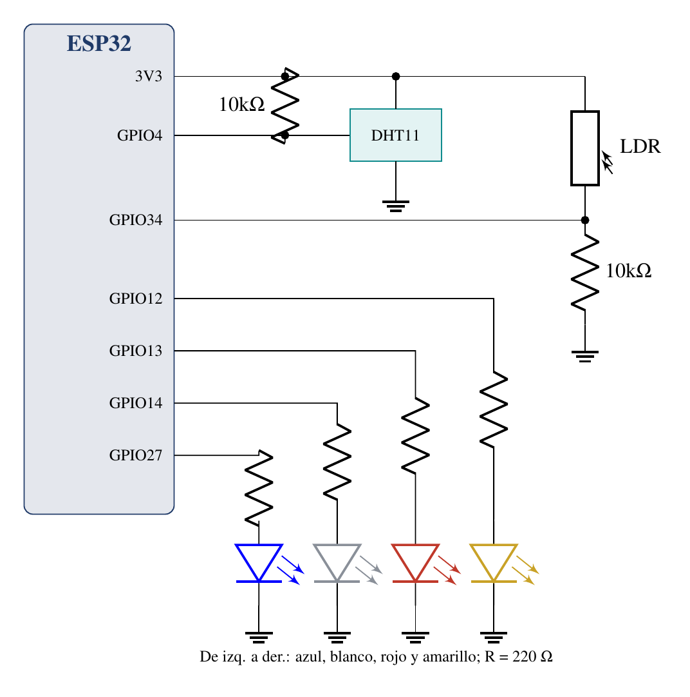
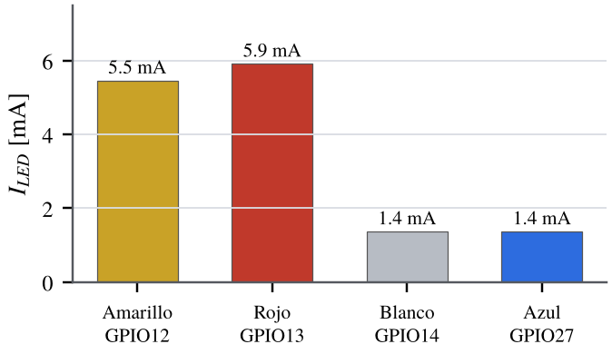
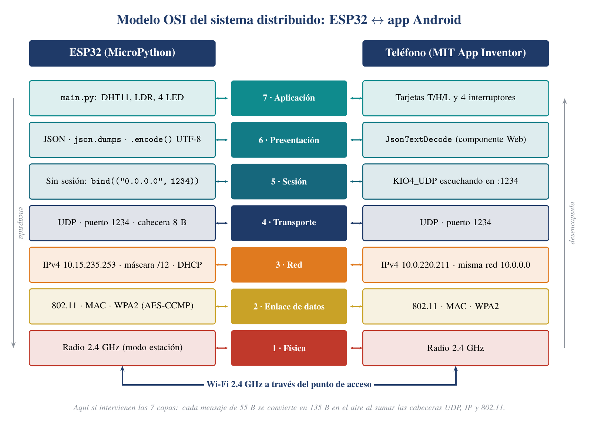
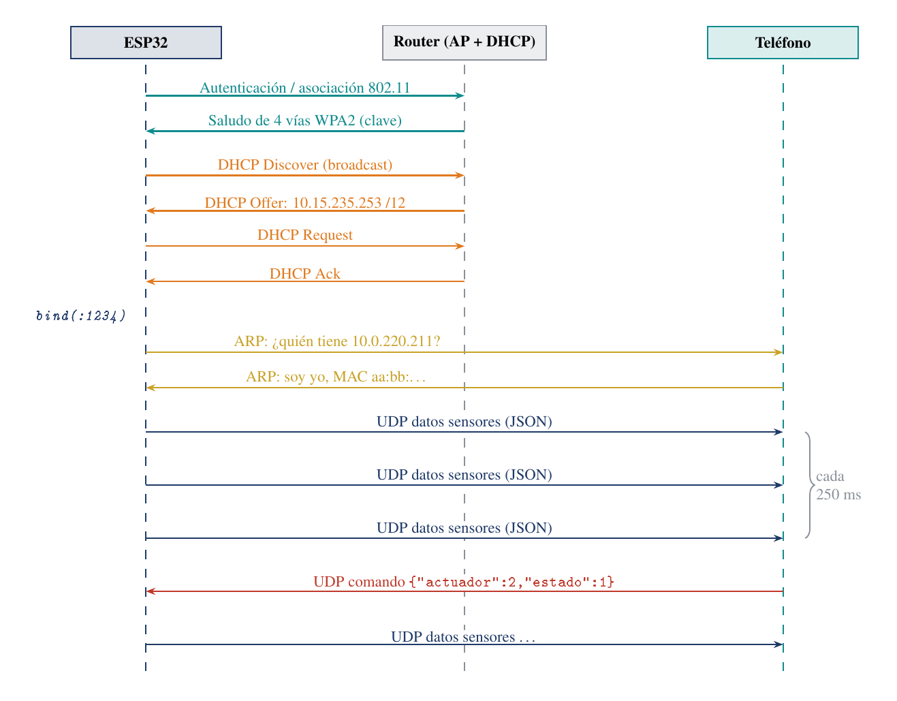
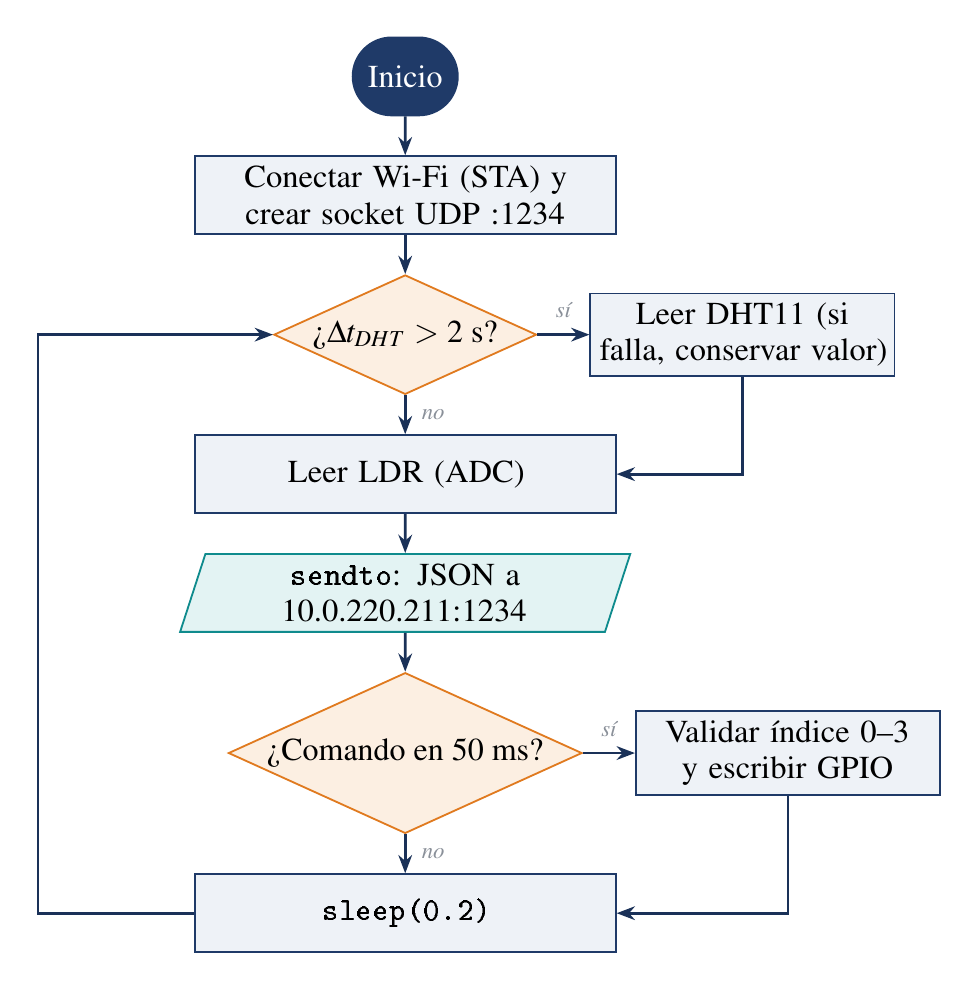
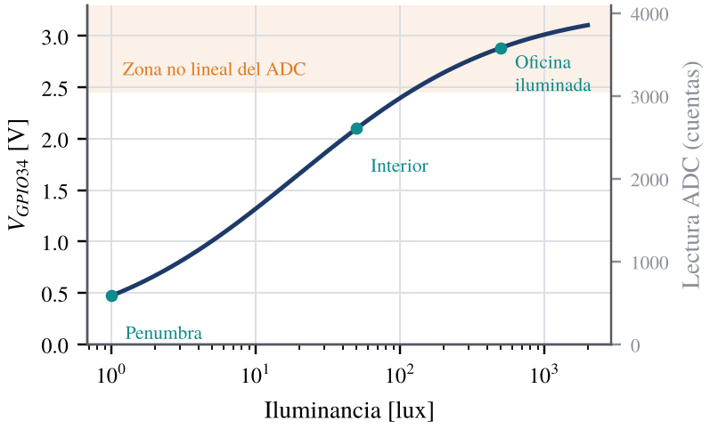

<p align="center"></p>

<p align="center">


</p>

<p align="center"><b>Un ESP32 y un celular, cada uno con su IP, intercambiando sensores y comandos<br>por Wi-Fi con datagramas UDP.</b></p>

---

## 📑 Contenido

1. [Descripción y objetivos](#-1-descripción-y-objetivos)
2. [Demostración](#-2-demostración)
3. [Ficha técnica](#-3-ficha-técnica)
4. [Arquitectura del sistema](#-4-arquitectura-del-sistema)
5. [Hardware y conexiones](#-5-hardware-y-conexiones)
6. [Modelo OSI](#-6-modelo-osi)
7. [Direcciones IP, máscaras y puertos](#-7-direcciones-ip-máscaras-y-puertos)
8. [Conexiones y mensajes](#-8-conexiones-y-mensajes)
9. [Funcionamiento paso a paso](#%EF%B8%8F-9-funcionamiento-paso-a-paso)
10. [Resultados y análisis](#-10-resultados-y-análisis)
11. [Hallazgos y mejoras](#-11-hallazgos-y-mejoras)
12. [Estructura y uso](#-12-estructura-y-uso)
13. [Informe](#-13-informe)

---

## 🎯 1. Descripción y objetivos

A diferencia de las prácticas anteriores, aquí no hay cable entre los equipos: el **ESP32** y el **teléfono** son dos nodos de una **red Wi-Fi**, cada uno con su propia dirección IP. El ESP32 lee la **temperatura y humedad (DHT11)** y la **luminosidad (LDR)** y las envía cada **250 ms (4 Hz)** en un **datagrama UDP** con formato **JSON**. Por el mismo puerto **1234** escucha los comandos que la **app de MIT App Inventor** envía al mover sus interruptores para encender o apagar **4 LED**.

Con un único socket el ESP32 es **cliente** (envía datos a la IP del celular) y **servidor** (recibe comandos en su puerto).

**Objetivos**
- Adquirir las variables y enviarlas a la IP del teléfono con una frecuencia mínima de 4 Hz.
- Recibir y ejecutar comandos de control sobre cuatro salidas digitales.
- Definir un formato de mensajes estructurado en ambos sentidos.
- Analizar el sistema con el modelo OSI, el direccionamiento IP, la latencia, la confiabilidad y la escalabilidad.

## 🎥 2. Demostración

<p align="center"><a href="https://youtube.com/shorts/pYm8S6QhzJE"></a><br><sub>▶ Clic para ver el video en YouTube</sub></p>

## 🧾 3. Ficha técnica

| Parámetro | Valor |
|---|---|
| Microcontrolador | ESP32 (MicroPython) · Wi-Fi 802.11 b/g/n 2.4 GHz · modo estación |
| Sensores | DHT11 (GPIO4) · LDR + 10 kΩ (GPIO34, ADC1) |
| Actuadores | 4 LED con 220 Ω (GPIO 12, 13, 14, 27) |
| Transporte | UDP · puerto 1234 · `SOCK_DGRAM` |
| Direcciones | ESP32 `10.15.235.253` · teléfono `10.0.220.211` · red 10.0.0.0/12 |
| Formato | JSON (55 B sensores · 28 B comandos) |
| Frecuencia | 4 Hz (200 ms de pausa + 50 ms de espera de comandos) |
| App | MIT App Inventor + extensión `KIO4_UDP` |

## 🧩 4. Arquitectura del sistema

<p align="center"></p>

Las líneas punteadas son la radio Wi-Fi a través del punto de acceso; las flechas, el flujo lógico de los datagramas.

<p align="center"><br><sub>Mapa conceptual de la práctica</sub></p>

## 🔌 5. Hardware y conexiones

| Elemento | GPIO | Función |
|---|:-:|---|
| DHT11 | **4** | Temperatura y humedad · bus de un hilo · máx. 1 lectura cada 1–2 s |
| LDR + 10 kΩ | **34** | ADC1 · 12 bits · 11 dB (el ADC2 no funciona con Wi-Fi activo) |
| LED amarillo · rojo · blanco · azul | **12 · 13 · 14 · 27** | Actuadores 0 a 3 |

<p align="center"> <br><sub>Esquema eléctrico · Corriente de cada LED: blanco y azul encienden más tenues (V<sub>F</sub> ≈ 3 V)</sub></p>

## 🌐 6. Modelo OSI

En este laboratorio **sí intervienen las siete capas**. El programa solo escribe las capas 5–7 (lógica, JSON y socket); el firmware de MicroPython (pila lwIP) resuelve UDP e IP, y el radio del ESP32 la trama 802.11 cifrada con WPA2.

<p align="center"></p>

| Capa | Qué hace en este sistema | Quién la implementa |
|---|---|---|
| 7 · Aplicación | Leer sensores, encender LED, mostrar valores | `main.py` · bloques de App Inventor |
| 6 · Presentación | Convertir dict ↔ texto JSON en UTF-8 | `json.dumps` · `JsonTextDecode` |
| 5 · Sesión | UDP no abre sesión; el socket queda escuchando | `bind(('0.0.0.0', 1234))` |
| 4 · Transporte | Puertos origen/destino 1234, cabecera de 8 B | lwIP (firmware) |
| 3 · Red | Direcciones IPv4 y máscara de subred | lwIP · DHCP del router |
| 2 · Enlace | Direcciones MAC, acceso al medio, cifrado WPA2 | Radio Wi-Fi |
| 1 · Física | Ondas de 2.4 GHz | Hardware RF |

<p align="center"><br><sub>Encapsulamiento: los 55 B de datos se convierten en 135 B en el aire (eficiencia 41 %)</sub></p>

## 🧮 7. Direcciones IP, máscaras y puertos

Dos equipos se comunican directamente solo si pertenecen a la **misma subred**, es decir, si al hacer `IP AND máscara` obtienen la misma dirección de red.

```text
ESP32     00001010.00001111.11101011.11111101   10.15.235.253
Teléfono  00001010.00000000.11011100.11010011   10.0.220.211
/24       11111111.11111111.11111111.00000000   → 10.15.235.0  ≠ 10.0.220.0   ❌
/12       11111111.11110000.00000000.00000000   → 10.0.0.0     = 10.0.0.0     ✅
```

| Máscara | Red | Broadcast | Hosts | ¿ESP32 y teléfono juntos? |
|---|---|---|---:|:-:|
| /8 · 255.0.0.0 | 10.0.0.0 | 10.255.255.255 | 16 777 214 | ✅ |
| **/12 · 255.240.0.0** | **10.0.0.0** | **10.15.255.255** | **1 048 574** | ✅ |
| /24 · 255.255.255.0 | 10.0.220.0 | 10.0.220.255 | 254 | ❌ |

**Puertos:** la IP identifica al equipo y el **puerto** al programa. Se usó el **1234**, del rango registrado (1024–49151), que no ocupa ningún servicio del sistema.

| Rango | Puertos | Ejemplos |
|---|---|---|
| Bien conocidos | 0 – 1023 | 53 DNS · 67/68 DHCP · 80 HTTP · 443 HTTPS |
| **Registrados** | 1024 – 49151 | **1234 (esta práctica)** · 1883 MQTT |
| Dinámicos | 49152 – 65535 | Puertos efímeros del sistema |

**¿Por qué UDP y no TCP?** Los datos se renuevan cada 250 ms: si uno se pierde, el siguiente ya trae información más reciente. UDP no hace saludo de tres vías ni espera confirmaciones, tiene una cabecera de solo 8 B y es más liviano para el ESP32.

| | UDP (usado) | TCP |
|---|---|---|
| Conexión | No | Saludo de 3 vías |
| Entrega y orden | Sin garantía | Garantizados |
| Cabecera | 8 B | ≥ 20 B |
| Latencia | Muy baja | Mayor (ACK) |

## 📨 8. Conexiones y mensajes

Antes del primer dato ocurren varias conexiones automáticas: asociación al punto de acceso y clave WPA2 (capa 2), obtención de IP por **DHCP** (capa 3) y resolución de la MAC del celular por **ARP**. Solo después viajan los datagramas UDP, sin ningún saludo previo.

<p align="center"> <br><sub>Secuencia de conexión · Cabecera UDP de un mensaje de sensores</sub></p>

```jsonc
// ESP32 → App  (cada 250 ms, 55 B)
{"temperatura": 24, "humedad": 61, "luminosidad": 2310}
// App → ESP32  (al mover un interruptor, 28 B)
{"actuador": 2, "estado": 1}
```

## ⚙️ 9. Funcionamiento paso a paso

1. 📶 El ESP32 se conecta a la red en modo estación y recibe su IP por DHCP.
2. 🔌 Crea un socket UDP (`AF_INET`, `SOCK_DGRAM`), lo enlaza al puerto 1234 y le da un *timeout* de 50 ms.
3. 🌡️ Cada 2 s lee el DHT11 (si falla, conserva el último valor); en cada ciclo lee la LDR.
4. 📤 Arma el JSON y lo envía con `sendto()` a `10.0.220.211:1234`.
5. 📥 Espera hasta 50 ms un comando con `recvfrom()`; si llega, valida el índice 0–3 y escribe el GPIO.
6. ⏸️ Duerme 200 ms y repite: ≈ 250 ms por ciclo → **4 Hz**.
7. 📱 La app decodifica el JSON, actualiza las tarjetas y, al mover un interruptor, envía el comando.

<p align="center"></p>

## 📊 10. Resultados y análisis

| Frecuencia real del ciclo | Latencia de los comandos |
|:-:|:-:|
|  |  |
| 200 + 50 ms + procesamiento ≈ 253 ms: el envío queda **justo en 4 Hz** y cae a 3.6 Hz al leer el DHT11. | El 20 % de los comandos se atiende al instante; la media es **≈ 80 ms** y el peor caso ≈ 200 ms. |
| **Respuesta de la LDR** | **Bytes por capa** |
|  |  |
| Con luz intensa la lectura entra en la zona no lineal del ADC (> 2.45 V). | A 4 Hz el sistema usa solo **4.3 kbit/s** de la red. |

## 💡 11. Hallazgos y mejoras

| Observación | Propuesta |
|---|---|
| La frecuencia queda en el límite de 4 Hz | Periodo fijo de 200 ms con `ticks_ms` |
| Un comando UDP perdido no se recupera | ACK del ESP32 o incluir `"leds":[1,0,0,1]` en cada mensaje |
| La IP del celular está fija en el código | Usar la IP de origen del último comando (`addr[0]`) |
| Si falla el Wi-Fi el programa queda en espera infinita | Timeout de conexión y reconexión automática |
| JSON en texto plano dentro de la red | Cifrado AES + HMAC en la capa de aplicación |
| GPIO12 es pin de arranque (*strapping*) | Mover ese LED a otro pin |

## 📁 12. Estructura y uso

```text
├── firmware/main.py   ← ESP32: Wi-Fi STA, socket UDP :1234, DHT11, LDR, 4 LED
├── app/Sp32.aia       ← proyecto de MIT App Inventor (extensión KIO4_UDP incluida)
└── docs/              ← informe IEEE (PDF) e imágenes
```

1. En `firmware/main.py` poner `WIFI_SSID`, `WIFI_PASS` y la IP del celular en `APP_IP`; copiarlo al ESP32.
2. Importar `app/Sp32.aia` en [MIT App Inventor](https://ai2.appinventor.mit.edu) y poner la IP que imprime el ESP32.
3. Conectar ESP32 y celular a la **misma red de 2.4 GHz** y abrir la app.

## 📄 13. Informe

📘 [**Informe IEEE completo (PDF)**](docs/Informe_Lab4_Conectividad_WiFi.pdf) — modelo OSI, subredes, cálculos de encapsulamiento, latencia, confiabilidad y escalabilidad.

---
<p align="center"><b>Universidad Militar Nueva Granada</b> · Ingeniería en Mecatrónica · Laboratorio de Micros · 2026<br>
Nicolas Santiago Pulido Buitrago (7004630) · Bryan Andrey Martínez Montaño (7004588)</p>
