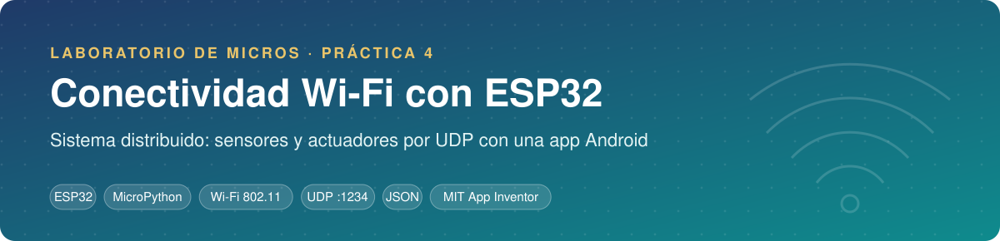
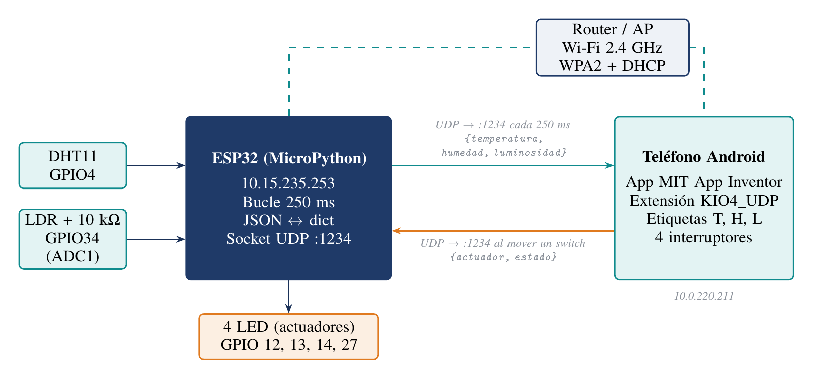
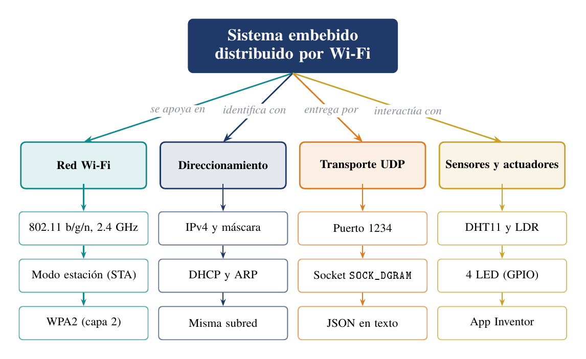
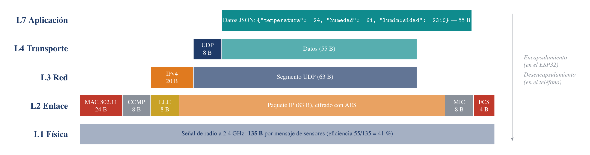
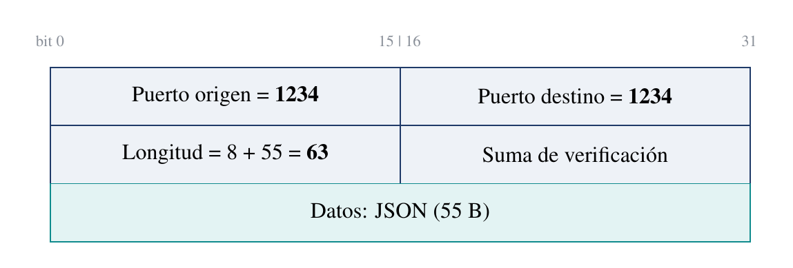
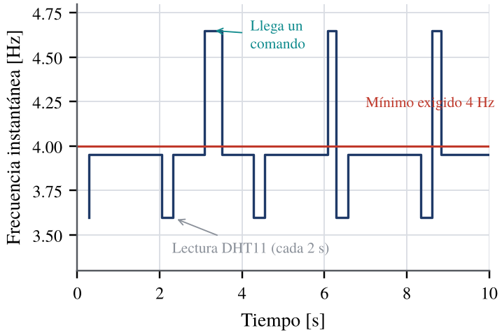
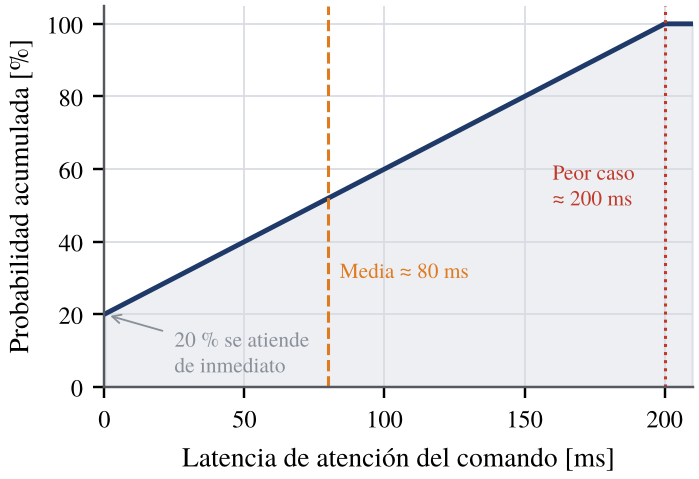
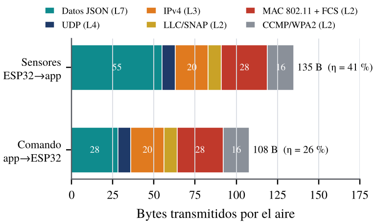

<p align="center"></p>

<p align="center">


</p>

> El **ESP32** lee **DHT11** (temperatura y humedad) y una **LDR**, envía los datos cada **250 ms (4 Hz)** por **UDP** a una **app Android** y recibe desde ella comandos para encender o apagar **4 LED**.

## 🎥 Demostración

<p align="center"><a href="https://youtube.com/shorts/pYm8S6QhzJE"></a><br><sub>▶ Clic para ver el video</sub></p>

## 🧩 Arquitectura

<p align="center"></p>

<p align="center"> <br><sub>Mapa conceptual · Esquema eléctrico</sub></p>

| Elemento | GPIO | Función |
|---|:-:|---|
| DHT11 | **4** | Temperatura y humedad (1 hilo) |
| LDR + 10 kΩ | **34** | ADC1 · 12 bits · 11 dB |
| LED amarillo · rojo · blanco · azul | **12 · 13 · 14 · 27** | Actuadores 0–3 |

## 🌐 Redes: modelo OSI, IP, máscaras y puertos

<p align="center"><br><sub>Encapsulamiento: 55 B de datos → 135 B en el aire (η = 41 %)</sub></p>

| Capa | En este sistema |
|---|---|
| 7–5 Aplicación | JSON + lógica (MicroPython) · App Inventor |
| 4 Transporte | **UDP**, puerto **1234**, cabecera de 8 B |
| 3 Red | IPv4 · ESP32 `10.15.235.253` · teléfono `10.0.220.211` |
| 2 Enlace | IEEE 802.11 · MAC · cifrado **WPA2 (AES-CCMP)** |
| 1 Física | Radio 2.4 GHz |

**¿Misma subred?** `Red = IP AND Máscara`

| Máscara | Red del ESP32 | Red del teléfono | ¿Comunican directo? |
|---|---|---|:-:|
| /24 · 255.255.255.0 | 10.15.235.0 | 10.0.220.0 | ❌ |
| **/12 · 255.240.0.0** | **10.0.0.0** | **10.0.0.0** | ✅ |

<p align="center"> <br><sub>Conexiones al arrancar (802.11 → WPA2 → DHCP → ARP → UDP) · Cabecera UDP</sub></p>

## 📨 Mensajes UDP

```jsonc
// ESP32 → App (cada 250 ms, 55 B)
{"temperatura": 24, "humedad": 61, "luminosidad": 2310}
// App → ESP32 (al mover un switch, 28 B)
{"actuador": 2, "estado": 1}
```

## 📊 Análisis

| Frecuencia real del ciclo | Latencia de los comandos |
|:-:|:-:|
|  |  |
| **Respuesta de la LDR** | **Bytes por capa** |
|  |  |

> [!IMPORTANT]
> El sistema usa solo **4.3 kbit/s** de la red y atiende los comandos en **~80 ms** de media. El ciclo de 200 ms + 50 ms deja la frecuencia en el **límite de 4 Hz**; un periodo fijo con `ticks_ms` lo resuelve (ver informe).

## 📁 Estructura

```text
├── firmware/main.py   ← ESP32: Wi-Fi STA, socket UDP :1234, DHT11, LDR, 4 LED
├── app/Sp32.aia       ← proyecto de MIT App Inventor (extensión KIO4_UDP)
└── docs/              ← informe IEEE (PDF) e imágenes
```

## ▶️ Uso rápido

1. En `firmware/main.py` poner `WIFI_SSID`, `WIFI_PASS` y la IP del celular en `APP_IP`; copiarlo al ESP32.
2. Importar `app/Sp32.aia` en [MIT App Inventor](https://ai2.appinventor.mit.edu) y poner la IP que imprime el ESP32.
3. Conectar ESP32 y celular a la **misma red de 2.4 GHz** y abrir la app.

## 📄 Informe

📘 [**Informe IEEE completo (PDF)**](docs/Informe_Lab4_Conectividad_WiFi.pdf)

---
<p align="center"><b>Universidad Militar Nueva Granada</b> · Ingeniería en Mecatrónica · Laboratorio de Micros · 2026<br>
Nicolas Santiago Pulido Buitrago · Bryan Andrey Martínez Montaño</p>
